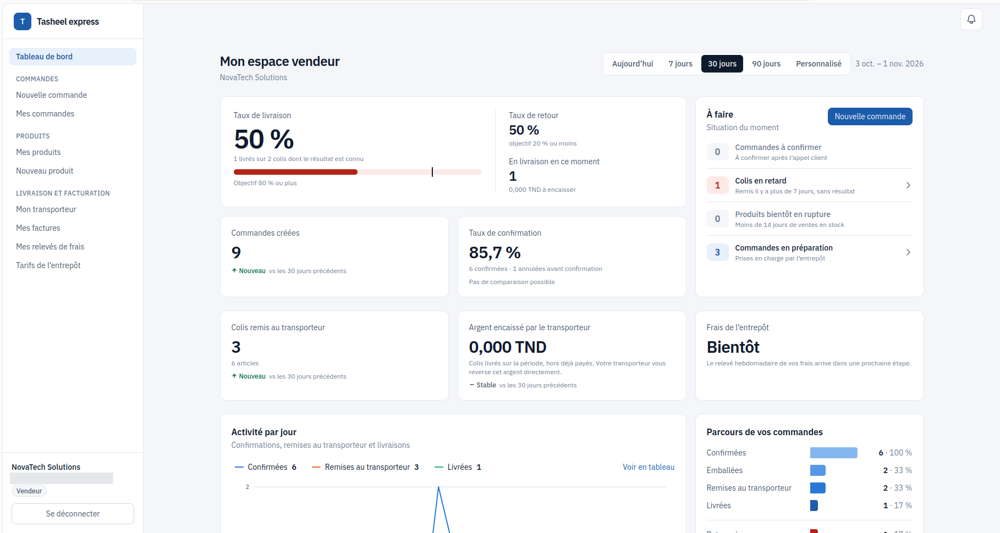
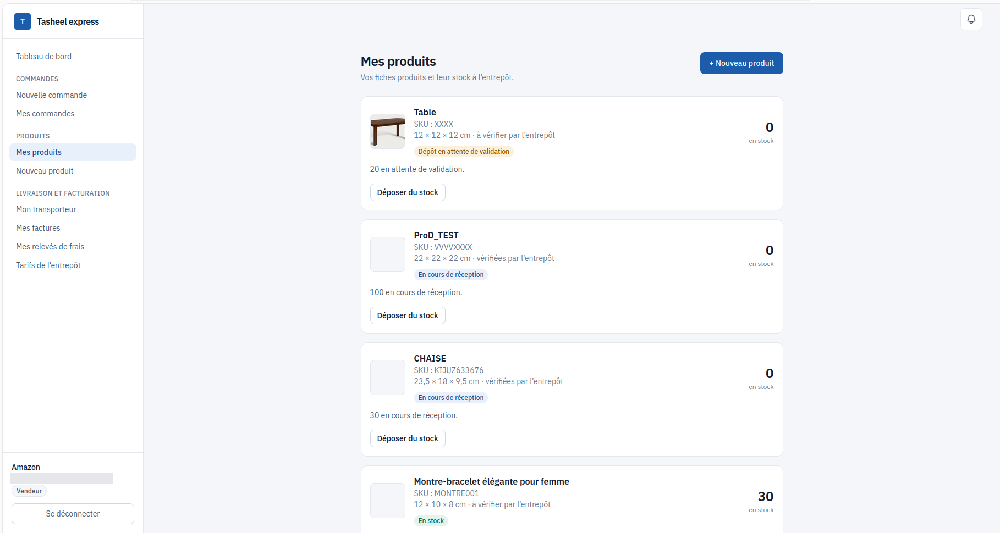
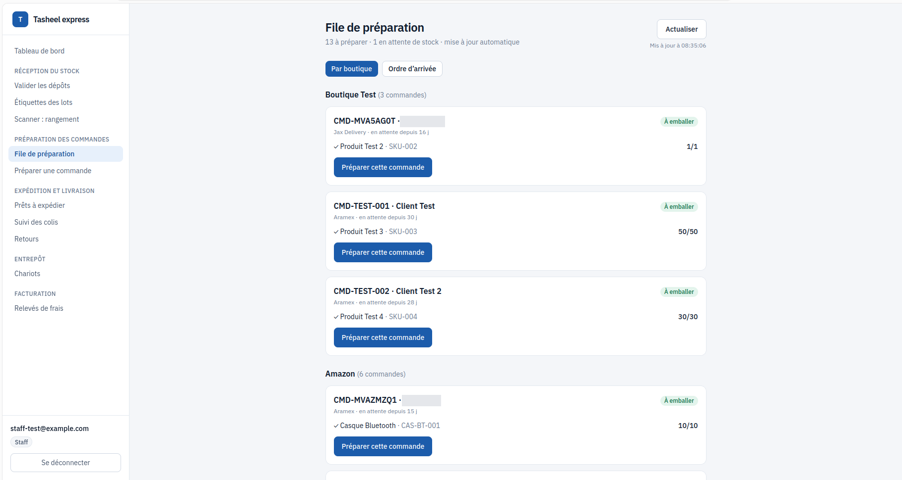
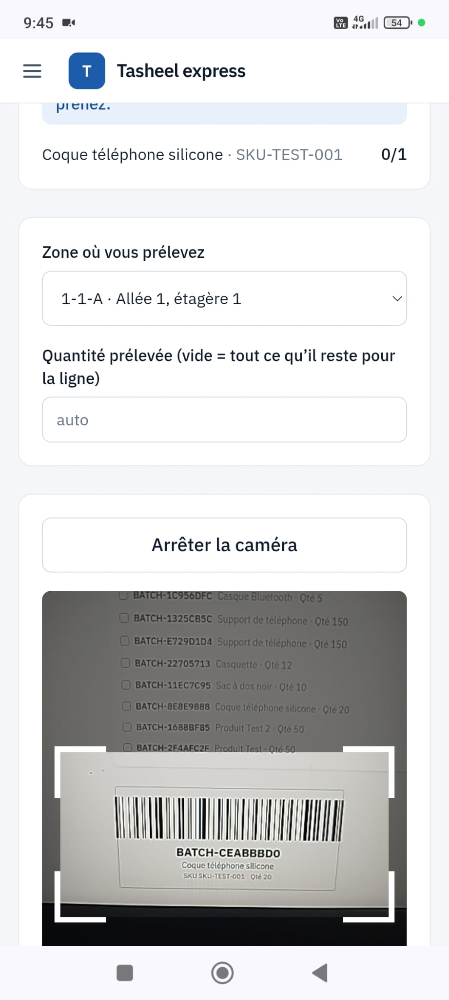
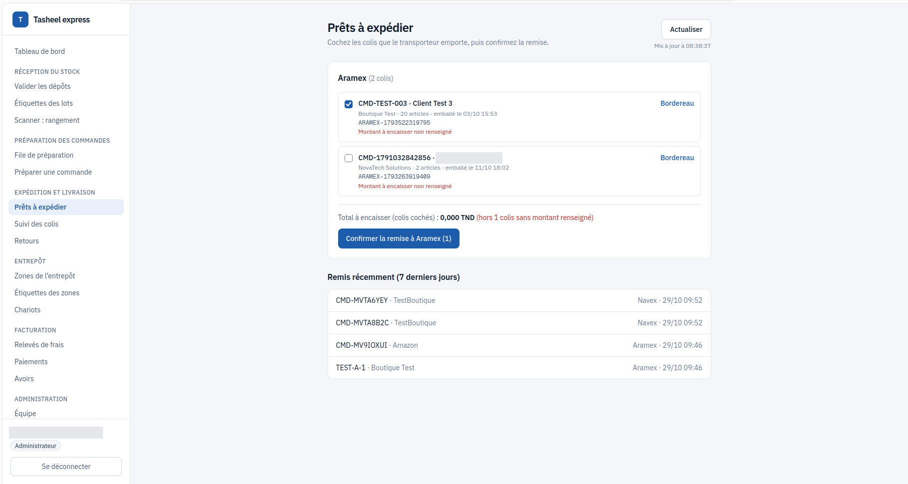
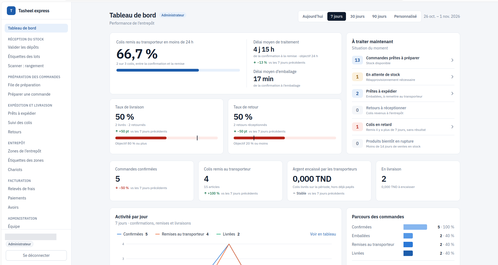

# Plateforme de fulfillment multi-vendeurs

Application web de gestion d'entrepôt pour e-commerçants : les vendeurs déposent leur stock, l'équipe de l'entrepôt le reçoit, prépare les commandes et les remet aux transporteurs.

**Statut :** en développement, phase de tests avant lancement.
**Code source privé** (projet réel) : démonstration possible sur demande.

## Contexte
Projet pour un entrepôt de fulfillment à El Jem (Tunisie), sur le modèle d'un « Fulfillment by Amazon » local. Chaque vendeur a son compte, saisit ses commandes et travaille avec la société de livraison de son choix ; l'entrepôt gère la réception, le rangement, la préparation et l'expédition.

## Fonctionnalités

**Vendeur**
- Création de produits et dépôt de stock
- Saisie et suivi des commandes (statuts, livraison, retours)
- Notifications et tableau de bord de statistiques
- Relevés de frais d'entrepôt en PDF

**Équipe de l'entrepôt (admin et staff)**
- Validation des dépôts et réception du stock
- File de préparation par vendeur, avec règle FIFO par produit
- Préparation guidée en 3 étapes par scan de codes (lecteur de codes-barres, QR codes, ou caméra du téléphone en complément, saisie manuelle possible) : prélèvement des lots, chariot, zone « Prêt à expédier »
- Bordereau imprimable et page « Prêts à expédier »
- Gestion des retours (réception, remise en stock, produits abîmés)
- Tableaux de bord de performance et gestion de l'équipe
  
## Architecture
- **Interface** : Next.js (TypeScript), déployée sur Vercel
- **Données et authentification** : Supabase (PostgreSQL, authentification par e-mail, e-mails en français)
- **Logique métier** : fonctions Edge de Supabase (lots, déduction du stock, bordereaux, relevés planifiés)
- **Accès aux données** : Row Level Security (RLS) PostgreSQL et vérification du rôle à chaque route
- **Extensible** : module transporteur générique, une nouvelle société de livraison s'ajoute sur le modèle existant

## Sécurité
- Isolation stricte des données entre vendeurs (RLS)
- Trois rôles (vendeur, admin, staff), routes protégées selon le rôle
- Identifiants des transporteurs enregistrés côté serveur, jamais côté client
- Documents PDF servis par liens signés

## Organisation du travail
Projet réalisé en binôme : une fonctionnalité = une branche = une pull request, relecture croisée, suivi des tâches par issues GitHub, convention de nommage commune.

## Ma contribution
Interface et expérience utilisateur (pages Next.js/TypeScript). Après la livraison des fonctions de mon binôme (base de données et logique métier), j'ai terminé les pages restantes et assuré les corrections.

## Captures d'écran

